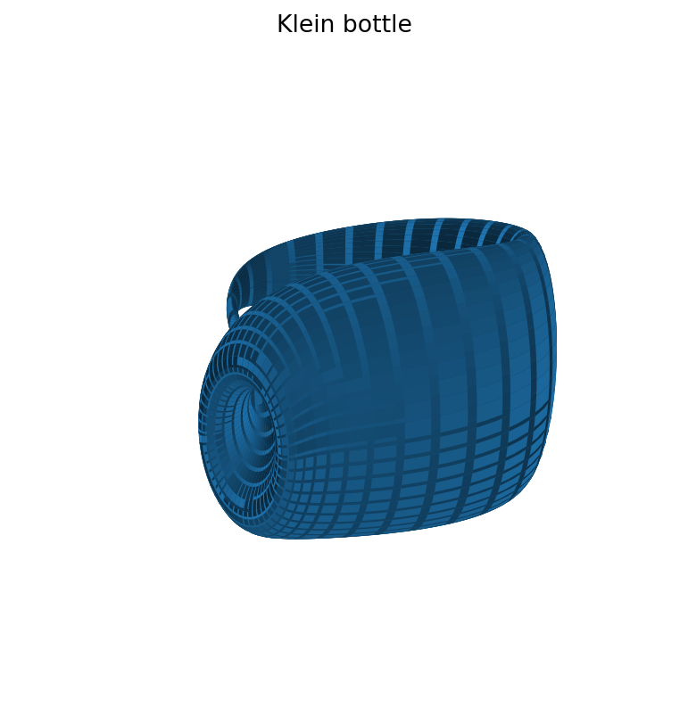

# XDSY118019 期末考试答案

## 第1题：Python 编程题

### (i) 输入参数校验与 (ii) Examples
完整 Python 实现见附件 `minkowski.py`。代码检查向量 `u`、`v`、权重 `w`，并检查 `p` 为正数；docstring 中提供了五个典型案例。

### (iii) Minkowski 距离计算结果
采用加权 Minkowski 距离定义：
$$d_{p,w}(u,v)=\\left(\\sum_i w_i|u_i-v_i|^p\\right)^{1/p}.$$
未提供权重时，所有权重取 1。

1. $u_1=(1,2,3), v_1=(3,2,1), p=2, w=(0.1,0.7,0.2)$
$$d_1=\\sqrt{0.1(2)^2+0.7(0)^2+0.2(2)^2}=\\sqrt{1.2}\\approx 1.0954451150 .$$

2. $u_2=(0,1,1,0,0,1), v_2=(1,0,0,1,1,0), p=0.5$
$$d_2=(1+1+1+1+1+1)^{1/0.5}=36.$$

3. $u_3=(0.1,0.5,-0.3,-1.2), v_3=(-0.5,1.5,0.3,0.6), p=3$
$$d_3=(0.6^3+1^3+0.6^3+1.8^3)^{1/3}\\approx 1.9366833187 .$$

## 第2题：Klein bottle 三维作图
参数方程按考试题 PDF 第2页抄录，$u,v\\in[0,2\\pi)$。Octave/MATLAB 脚本见 `klein.m`，使用 `surf` 绘图并保存为 `klein_bottle.png`。

$$
x(u,v)=-\\frac{2}{15}\\cos u(3\\cos v-30\\sin u+90\\cos^4u\\sin u-60\\cos^6u\\sin u+5\\cos u\\cos v\\sin u)
$$
$$
\\begin{aligned}
y(u,v)=-\\frac{1}{15}\\sin u(&3\\cos v-3\\cos^2u\\cos v-48\\cos^4u\\cos v+48\\cos^6u\\cos v-60\\sin u\\\\
&+5\\cos u\\cos v\\sin u-5\\cos^3u\\cos v\\sin u-80\\cos^5u\\cos v\\sin u+80\\cos^7u\\cos v\\sin u)
\\end{aligned}
$$
$$z(u,v)=\\frac{2}{15}(3+5\\cos u\\sin u)\\sin v.$$

## 第3题：Mathematica

### (i) Infinite series
$$\\boxed{\\sum_{n=1}^{\\infty}\\frac{(-1)^{n+1}\\sin n}{n}=\\frac12}$$

### (ii) Indefinite integral
$$\\boxed{\\int\\sqrt{\\tan x}\\,dx=
\\frac23(\\tan x)^{3/2}{}_2F_1\\left(1,\\frac34;\\frac74;-\\tan^2x\\right)+C}$$
其中 ${}_2F_1$ 为 Gauss 超几何函数，$C$ 为积分常数。

## 第4题：Navier–Stokes Equations

The Navier–Stokes momentum equation can be derived as a particular form of the Cauchy momentum equation, whose general convective form is:

$$\\frac{D\\mathbf{u}}{Dt}=\\frac{1}{\\rho}\\nabla\\cdot\\boldsymbol{\\sigma}+\\mathbf{a}.$$

By setting the Cauchy stress tensor $\\boldsymbol{\\sigma}$ to be the sum of a viscosity term $\\boldsymbol{\\tau}$ (the deviatoric stress) and a pressure term $-p\\mathbf{I}$ (volumetric stress), we arrive at:

$$\\rho\\frac{D\\mathbf{u}}{Dt}=-\\nabla p+\\nabla\\cdot\\boldsymbol{\\tau}+\\rho\\mathbf{a}.$$

where

- $\\dfrac{D}{Dt}$ is the material derivative, defined as $\\dfrac{\\partial}{\\partial t}+\\mathbf{u}\\cdot\\nabla$,
- $\\rho$ is the (mass) density,
- $\\mathbf{u}$ is the flow velocity,
- $\\nabla\\cdot$ is the divergence,
- $p$ is the pressure,
- $t$ is time,
- $\\boldsymbol{\\tau}$ is the Deviatoric stress|deviatoric stress tensor, which has order 2,
- $\\mathbf{a}$ represents body forces acting on the continuum, for example gravity, Fictitious force|inertial accelerations, Coulomb's law|electrostatic accelerations, and so on.

In this form, it is apparent that in the assumption of an inviscid fluid – no deviatoric stress – Cauchy equations reduce to the Euler equations.
